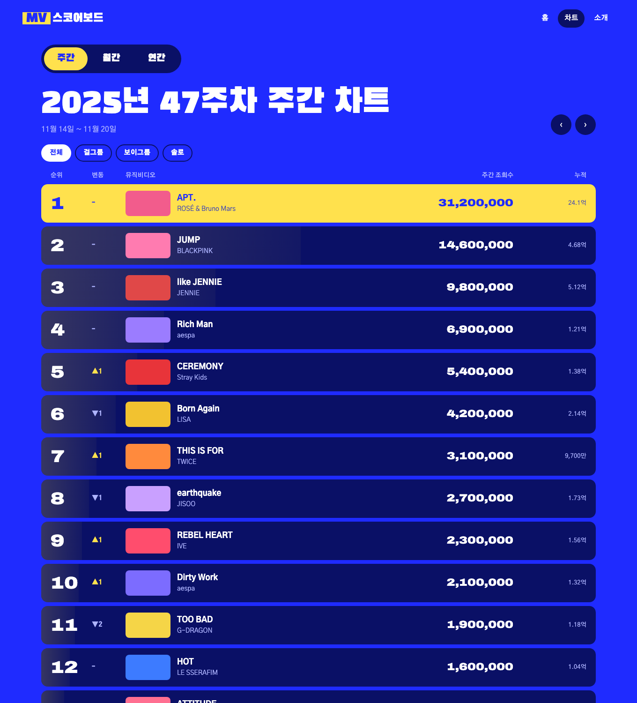
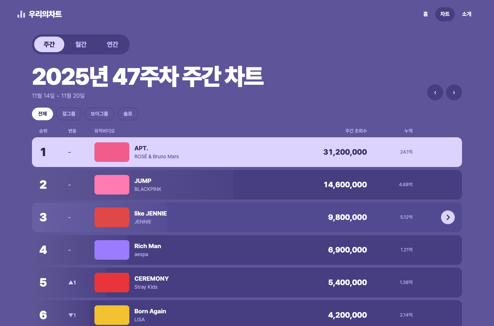

# 디자인 변경 기록

PR을 만들 때마다 base 브랜치(변경 전)와 PR 브랜치(변경 후)의 화면을 캡처해 남깁니다. 최신 기록이 위에 옵니다.
폴더 이름 규칙: `NN-YYYYMMDD-브랜치이름/before`, `.../after`

---

## 01 · 2026-11-21 · 라벤더 톤 + Pretendard + 호버 레이싱 화살표

**요청:** 1번(스코어보드) 시안 채택. 폰트를 Pretendard로 통일, 사이트 이름을 "우리의차트"로, 파랑 대신 튀지 않는 라벤더 계열로. 차트 행에 마우스를 올리면 `>>>`가 오른쪽으로 달려가며 보러가기 `>` 버튼이 나타나도록.

**바뀐 점**
- 폰트: Black Han Sans + Archivo + Gothic A1 → Pretendard 하나로 통일
- 이름/로고: "MV 스코어보드" → "우리의차트" (막대 3개 로고)
- 색: 배경 `#1F2BFF` → `#5D5499`, 강조 노랑 `#FFE14D` → 옅은 라벤더 `#DCD3FF`
- 차트 행: 호버 시 레이싱 화살표 + 원형 `>` 버튼, 클릭하면 유튜브로 이동 (홈 TOP 5에도 적용)

| | 변경 전 | 변경 후 |
|---|---|---|
| 홈 |  |  |
| 차트 |  |  |
| 차트 호버 | (호버 효과 없음) |  |

> 참고: 이 기록은 PR 기준 규칙을 정하기 전, 시안 단계에서 만든 것입니다. 이 기록의 "변경 전" 홈 이미지는 기록 규칙을 만들기 전에 찍어둔 것이라, 실제 직전 상태와 히어로 아래 문구 한 줄이 다릅니다.
