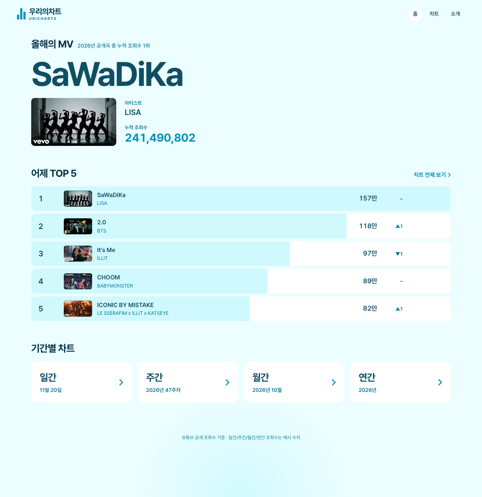
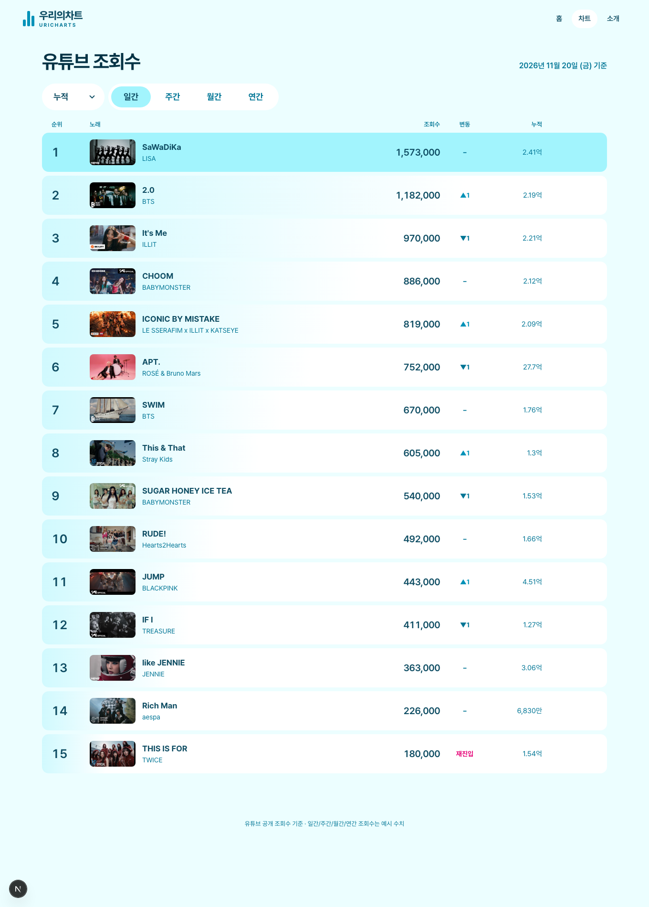
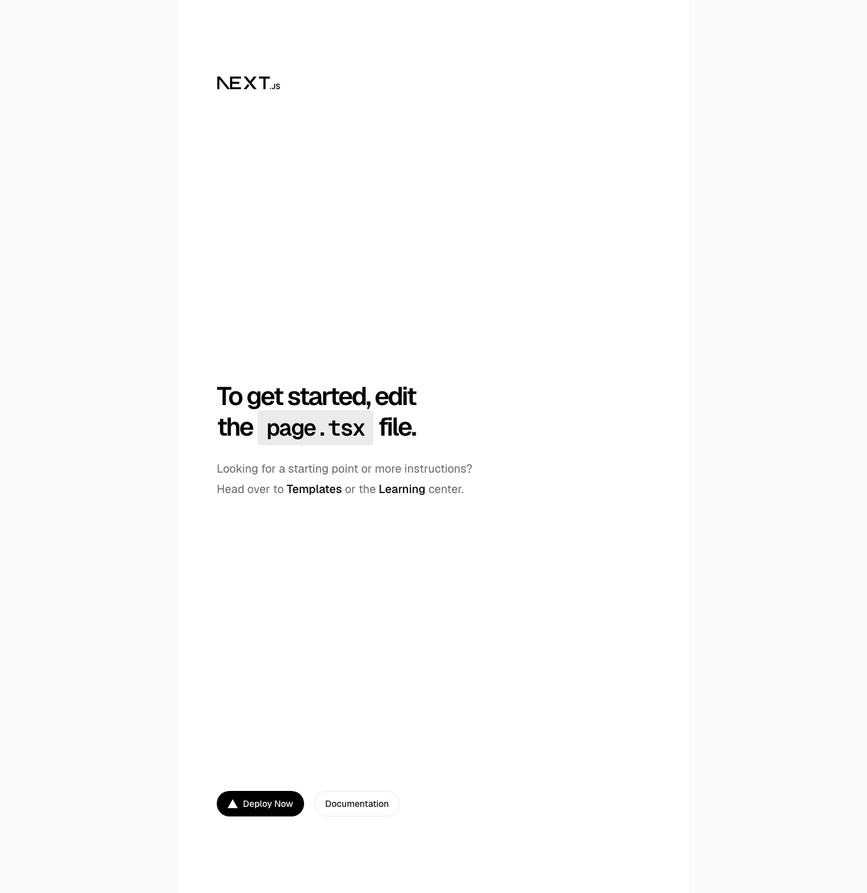
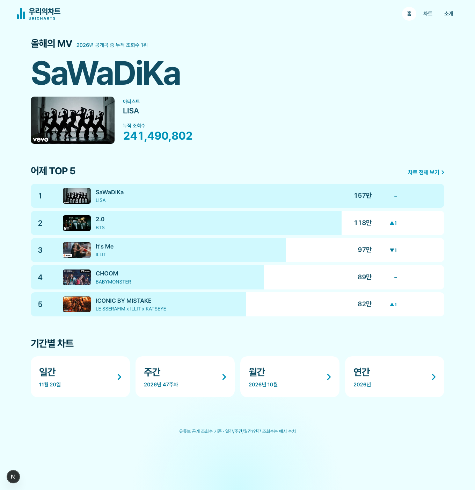
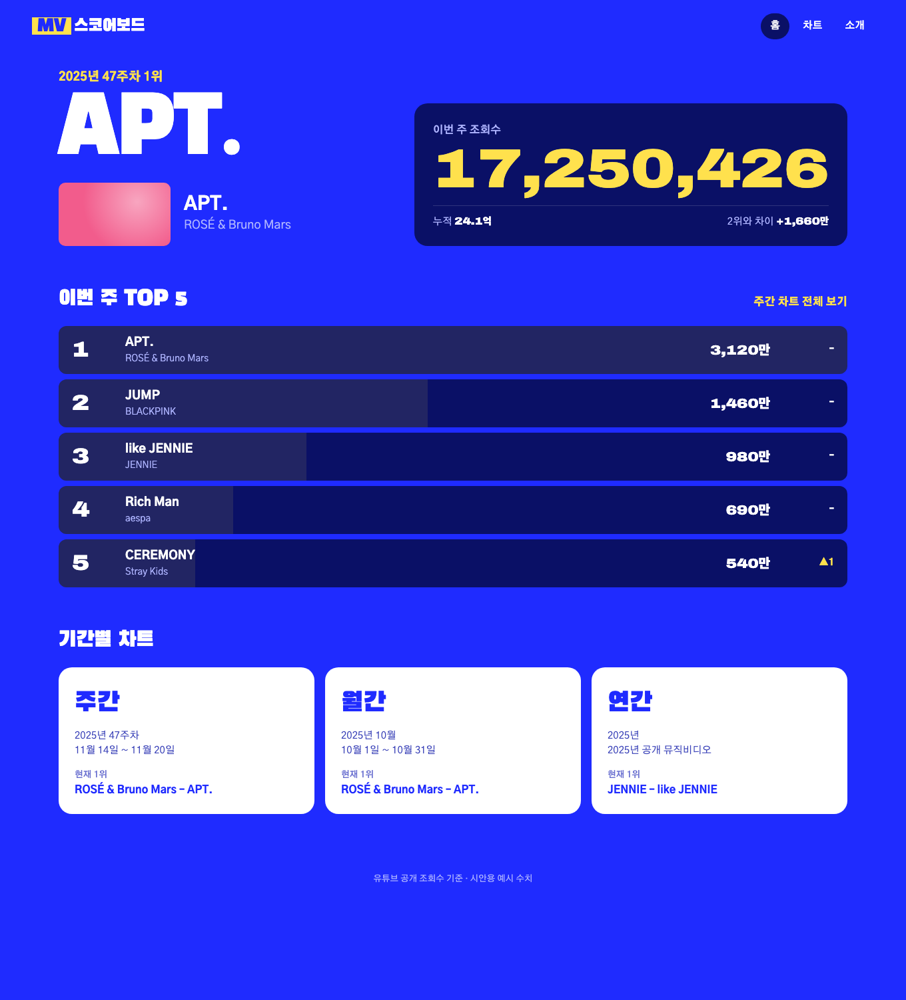
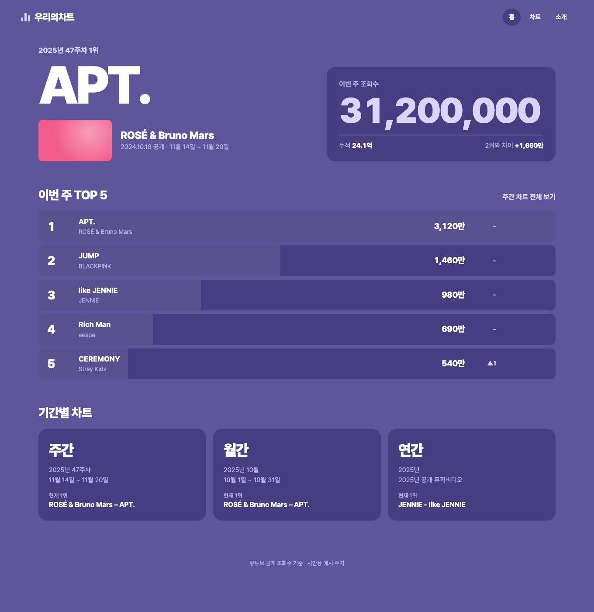
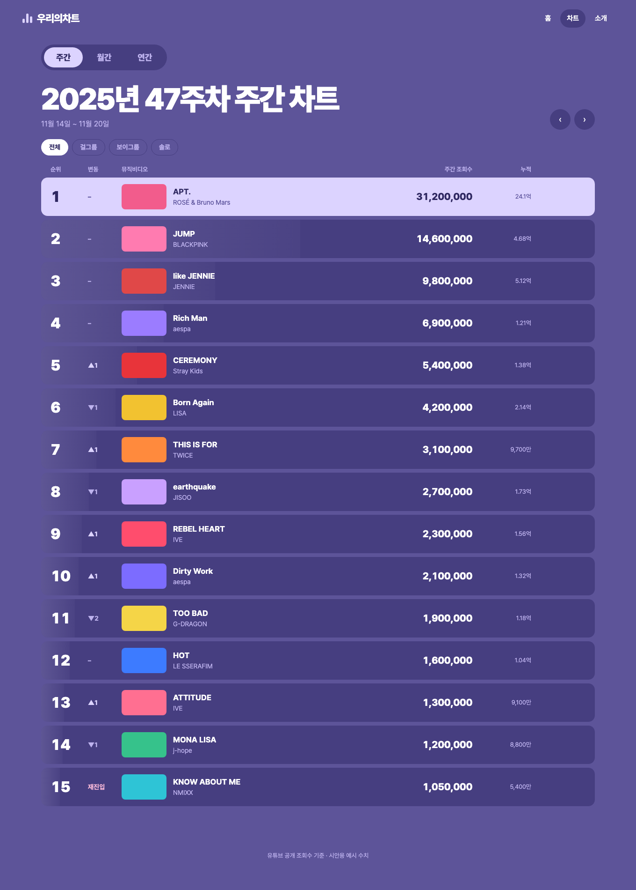

# 디자인 변경 기록

PR을 만들 때마다 base 브랜치(변경 전)와 PR 브랜치(변경 후)의 화면을 캡처해 남깁니다. 최신 기록이 위에 옵니다.
폴더 이름 규칙: `NN-YYYYMMDD-브랜치이름/before`, `.../after`

---

## 03 · 2026-11-21 · 헤더·푸터 개편, 누적 TOP 5, 뮤직비디오 모달 (develop → main)

**바뀐 점**
- 헤더: 상단 고정(스크롤하면 옅은 그림자), 로고를 cyan 타일 안 흰 막대로. 메뉴는 "YouTube 조회수" · "우리의차트는?" 두 개(홈은 로고), 선택 표시 알약이 메뉴 사이를 미끄러져 이동
- 푸터: 한 줄 안내문 → 깊은 청록 "엔딩 크레딧" 판 (소개 · 문의, ©, 아래로 잘려 걸린 URICHARTS 큰 글자)
- 홈: "어제 TOP 5" → "일간 누적 TOP 5" + 기준일("2026년 11월 20일"), 변동 칸 제거, "차트 전체 보기" → "더보기"
- 차트: 제목 "유튜브 조회수" → 유튜브 아이콘 + "YouTube 조회수", 1위 행 채움 강조 제거, 100위까지 표시
- 아이콘: 직접 그린 꺾쇠 → akar-icons
- 인터랙션 (캡처에는 안 보임)
  - 순위 행을 누르면 유튜브 새 창 대신 화면을 어둡게 덮는 뮤직비디오 모달에서 바로 재생
  - 범위 드롭다운을 기본 select 대신 직접 그린 알약 목록으로 (키보드 ↑↓/Enter/Esc)
  - 로고 호버: 막대가 이퀄라이저처럼 출렁임 / 기간 카드 호버: 흐르는 cyan 그라데이션
  - 홈 TOP 5: 조회수가 평소 오른쪽 끝에 있다가 호버하면 왼쪽으로 비켜 `>` 버튼 자리를 내줌

| | 변경 전 (main) | 변경 후 |
|---|---|---|
| 홈 |  |  |
| 차트 |  |  |

> 알려진 문제: 변경 후 차트 페이지 본문이 1184px보다 좁게(내용 폭만큼) 그려진다. `body`가 `flex flex-col`이 되면서 `mx-auto`인 `main`이 내용 폭으로 줄어든 것으로 보인다.

---

## 02 · 2026-11-21 · 홈/차트 페이지 Next.js 구현 (develop → main)

**요청:** HTML 시안(`mockups/`)으로 다듬은 홈·차트 디자인을 실제 Next.js 프로젝트로 옮기고, 시안 파일은 정리.

**바뀐 점**
- 색: 라벤더 → Tailwind cyan 팔레트. 폰트 Pretendard 유지
- 홈: 올해의 MV(누적 조회수 카운트업) · 어제 TOP 5 · 기간별 차트 카드
- 차트 페이지 새로 추가 (`/mv/chart/day|week|month|year`)
  - 제목 "유튜브 조회수" + 오른쪽에 기준일 ("2026년 11월 20일 (금) 기준")
  - 기간 탭: 일간 · 주간 · 월간 · 연간 (기본 일간)
  - 범위 드롭다운: 누적(모든 곡) / 공개연도(고른 연도에 공개된 곡만, 오른쪽에 연도 드롭다운)
  - 표: 순위 · 노래 · 조회수 · 변동 · 누적 (연간 + 올해 공개곡이면 누적 대신 하루 평균)
  - 그룹 필터 칩, ‹ › 이전/다음 기간 버튼, 기간별 큰 제목은 시안 단계에서 뺌
- 인터랙션 (캡처에는 안 보임): 행에 마우스를 올리면 `>>>`가 **한 번만** 지나가고(1.1초) 끝에 `>` 버튼이 나타남. 홈 TOP 5도 동일
- 썸네일이 뜨기 전 자리 색을 곡별 색 대신 cyan으로 통일

| | 변경 전 (main) | 변경 후 |
|---|---|---|
| 홈 |  |  |
| 차트 | (페이지 없음) |  |

> 참고: main의 홈은 Next.js 기본 시작 페이지라, 직전 디자인과 비교하려면 01 기록의 시안 캡처(`01-20261121-lavender-pretendard/after/`)를 함께 본다.
> 캡처 왼쪽 아래 `N` 배지는 Next.js 개발 서버 표시로, 배포 화면에는 없다.

---

## 01 · 2026-11-21 · 라벤더 톤 + Pretendard + 호버 레이싱 화살표

**요청:** 1번(스코어보드) 시안 채택. 폰트를 Pretendard로 통일, 사이트 이름을 "우리의차트"로, 파랑 대신 튀지 않는 라벤더 계열로. 차트 행에 마우스를 올리면 `>>>`가 오른쪽으로 달려가며 보러가기 `>` 버튼이 나타나도록.

**바뀐 점**
- 폰트: Black Han Sans + Archivo + Gothic A1 → Pretendard 하나로 통일
- 이름/로고: "MV 스코어보드" → "우리의차트" (막대 3개 로고)
- 색: 배경 `#1F2BFF` → `#5D5499`, 강조 노랑 `#FFE14D` → 옅은 라벤더 `#DCD3FF`
- 차트 행: 호버 시 레이싱 화살표 + 원형 `>` 버튼, 클릭하면 유튜브로 이동 (홈 TOP 5에도 적용)

| | 변경 전 | 변경 후 |
|---|---|---|
| 홈 |  |  |
| 차트 |  |  |
| 차트 호버 | (호버 효과 없음) |  |

> 참고: 이 기록은 PR 기준 규칙을 정하기 전, 시안 단계에서 만든 것입니다. 이 기록의 "변경 전" 홈 이미지는 기록 규칙을 만들기 전에 찍어둔 것이라, 실제 직전 상태와 히어로 아래 문구 한 줄이 다릅니다.
