# 디자인 변경 기록

PR을 만들 때마다 base 브랜치(변경 전)와 PR 브랜치(변경 후)의 화면을 캡처해 남깁니다. 최신 기록이 위에 옵니다.
폴더 이름 규칙: `NN-YYYYMMDD-브랜치이름/before`, `.../after`

---

## 07 · 2026-11-25 · 공개연도별 차트 (연도 드롭다운 · 누적 칸 · 마감 안내) (develop → main)

**바뀐 점**
- 차트 제목: "YouTube K-POP MV 조회수" → "K-POP MV 조회수 순위" (유튜브 아이콘은 그대로)
- 차트: 기간 탭 왼쪽에 연도 드롭다운(`2026년 ⌄`). 그 해에 공개된 곡만 순위를 매기고, 펼치면 집계 중인 해에 "● 집계 중"이 붙음 (펼친 모습은 캡처에 없음)
- 차트 위 설명 문장("2026년에 공개된 K-POP MV … 순위예요.") 삭제
- 기간 이름에서 연도를 뺌: "2026년 11월 22일 (일)" → "11월 22일 (일)", "2026년 47주차" → "47주차", 주간 범위에 요일과 7일이 아닌 주의 날 수(" · 4일")
- ‹ › 이동은 그 해 안에서만. 연간은 연도를 드롭다운에서 고르니 ‹ 2026년 › 줄이 없어짐
- 고를 수 있는 기간이 없을 때(예: 지금의 일간, 새해 1월의 월간) 기간 이름을 흐리게 두고 누를 수 없게, 아래는 "아직 집계 중이에요"만
- 월간은 끝난 달만 (11월이 안 끝났으면 10월까지)
- 일간·주간·월간 표에 "누적" 칸(기간 끝 기록의 전체 조회수)을 조회수 왼쪽에. 변동에 "NEW"(이번 기간에 공개된 곡)
- 마감된 해를 보면 표 위에 진한 안내 카드 "2026년 차트는 마감됐어요 / 2026년 12월 31일까지의 최종 순위예요." + "2027년 차트 보기" 버튼
- 사이트 아이콘(파비콘·애플 아이콘)을 헤더 로고와 같은 막대 3개 타일로

| | 변경 전 (main) | 변경 후 |
|---|---|---|
| 홈 | 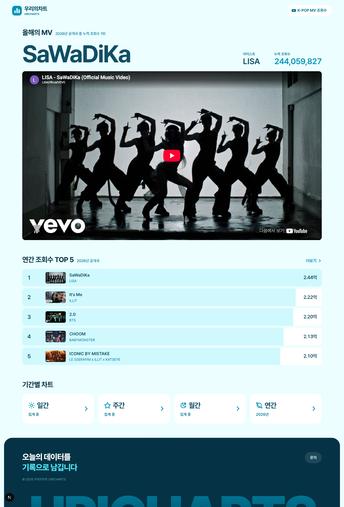 |  |
| 차트 (일간) |  | 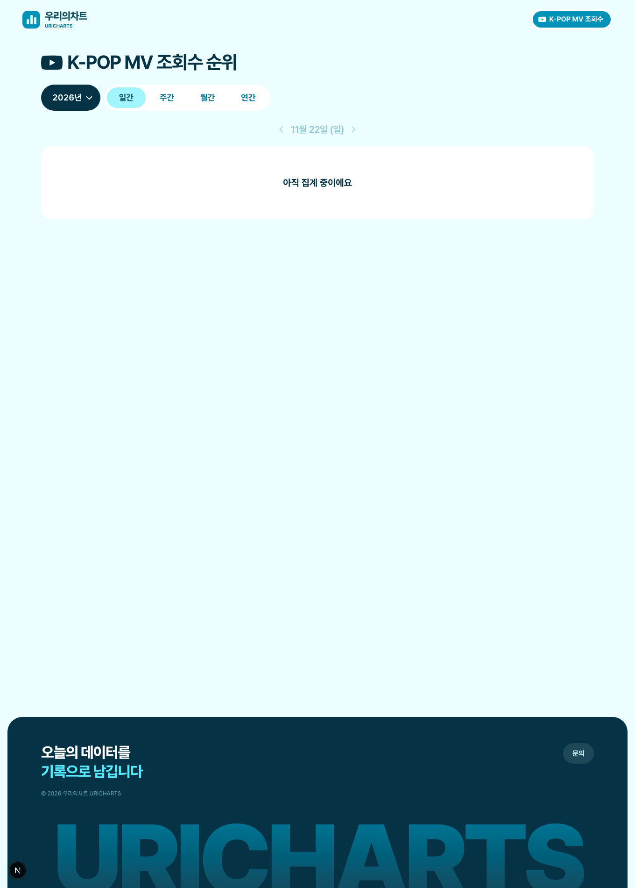 |
| 차트 (연간) |  | 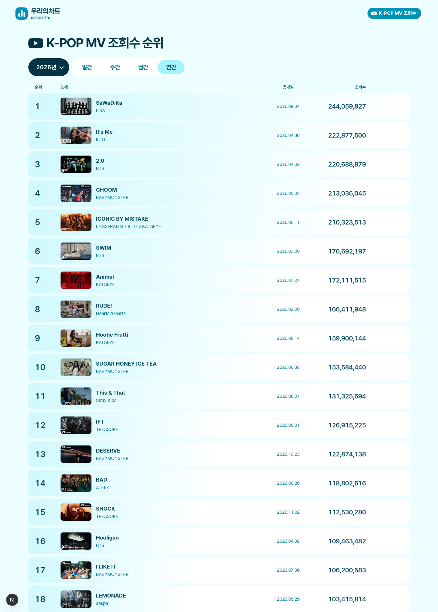 |
| 소개 |  |  |

실제 기록이 아직 이틀치라 누적 칸·마감 카드는 위 캡처에 안 나온다. 아래는 2026-12 ~ 2027-01 가짜 기록으로 띄워 찍은 참고 화면이다 (곡·숫자는 예시).

| 2027년 2주차 (누적·변동) | 2026년 53주차 (짧은 주 · 마감 카드) |
|---|---|
| 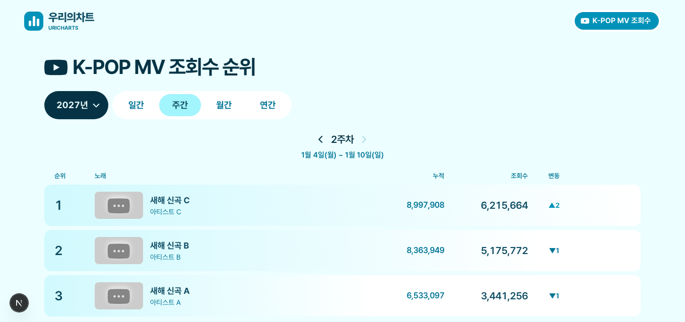 | 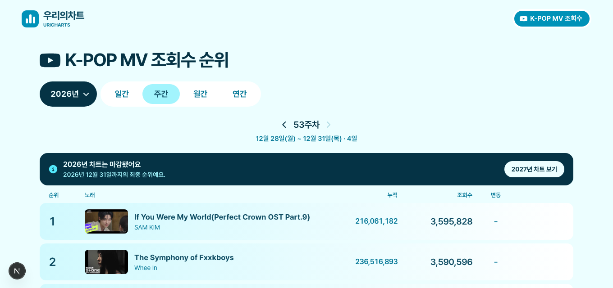 |

---

## 06 · 2026-11-24 · 지난 기간 고르기, 홈 연간 TOP 5, 소개 페이지 (develop → main)

**바뀐 점**
- 차트: 범위 드롭다운(누적/공개연도)을 없애고, 차트는 늘 그 기간이 속한 해에 공개된 곡만 보여줌. 설명 문구도 "2026년에 공개된 K-POP MV … 순위예요."로
- 차트: 표 위에 기간 고르기(‹ 2026년 11월 22일 (일) ›) 추가. 지난 하루·주·달·해를 `/mv/chart/[period]/[key]` 주소로 볼 수 있음. 제목 오른쪽 "… 기준" 문구는 빠짐
- 연간 차트: 변동 칸 대신 공개일 칸(2026.09.04), 보여주는 순위를 100위 → 150위로
- 집계 중 빈 카드: "매일 0시에 조회수를 기록해요." 대신, 볼 수 있게 되는 날을 알면 "○월 ○일부터 볼 수 있어요."
- 홈: "누적 일간 조회수 TOP 5" → "연간 조회수 TOP 5 · 2026년 공개곡" (올해 공개곡 연간 차트 1~5위, 더보기는 연간 차트로)
- 헤더: 메뉴 이름 "YouTube 조회수" → "K-POP MV 조회수", "우리의차트는?" 메뉴 숨김. 푸터의 "소개" 링크도 숨김
- 새 페이지: 소개(`/about`) — 질문·답 말풍선으로 차트 읽는 법 설명. 공개 전이라 메뉴에 없고 noindex. 답 말풍선이 뜰 때 "쓰는 중" 점 세 개가 통통 튀는 애니메이션이 있음 (캡처는 모션 감소 모드라 최종 상태만 찍힘)

| | 변경 전 (main) | 변경 후 |
|---|---|---|
| 홈 | 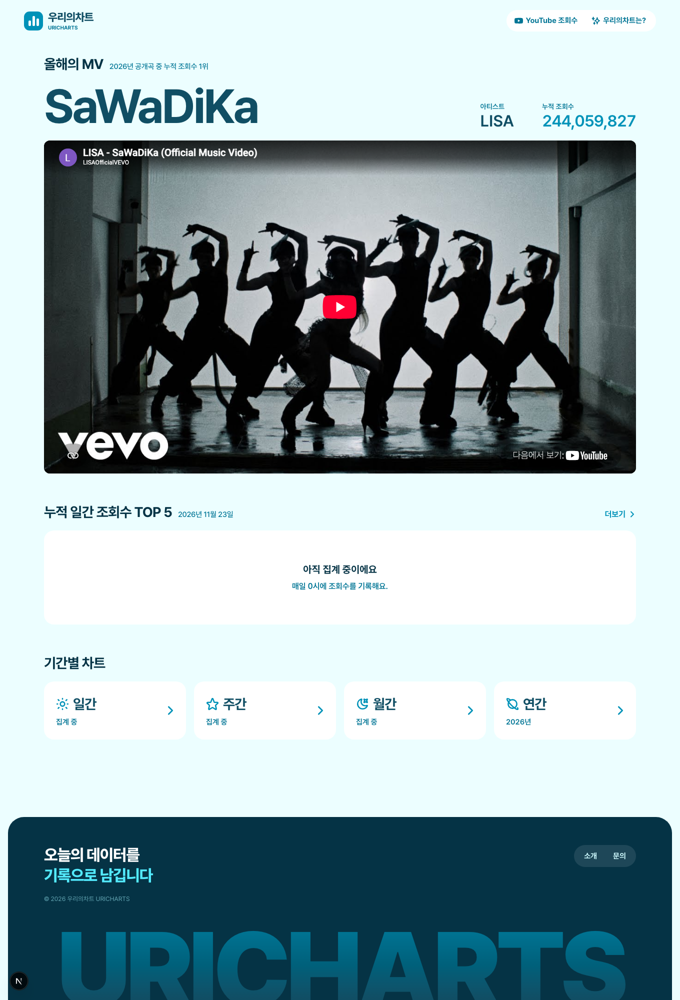 | 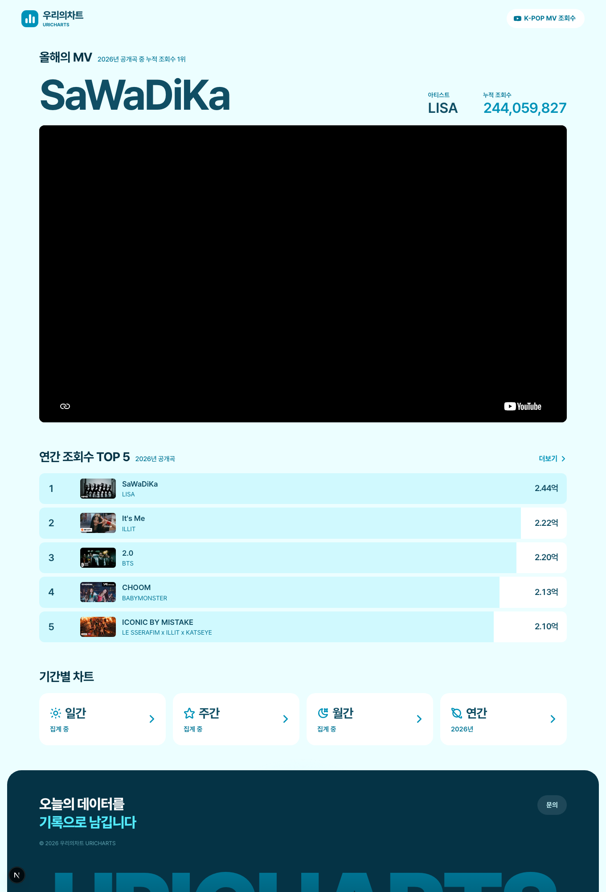 |
| 차트 (일간) |  | 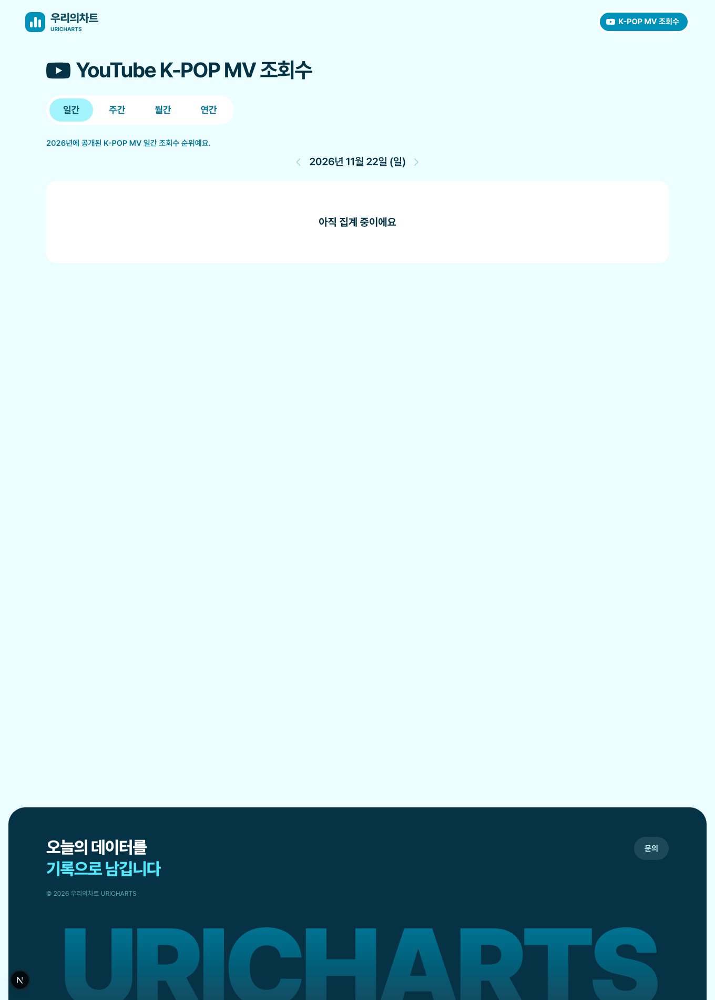 |
| 차트 (연간) | 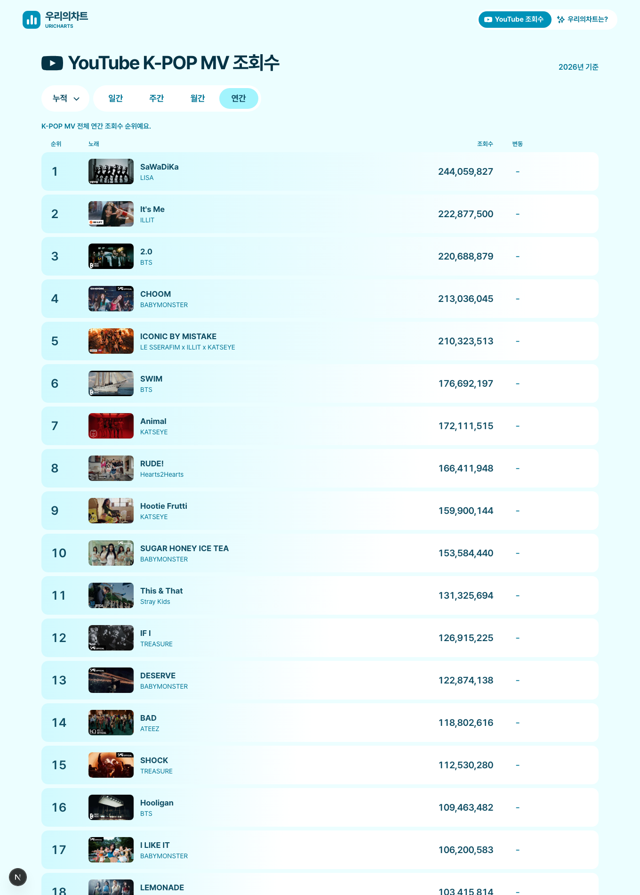 | 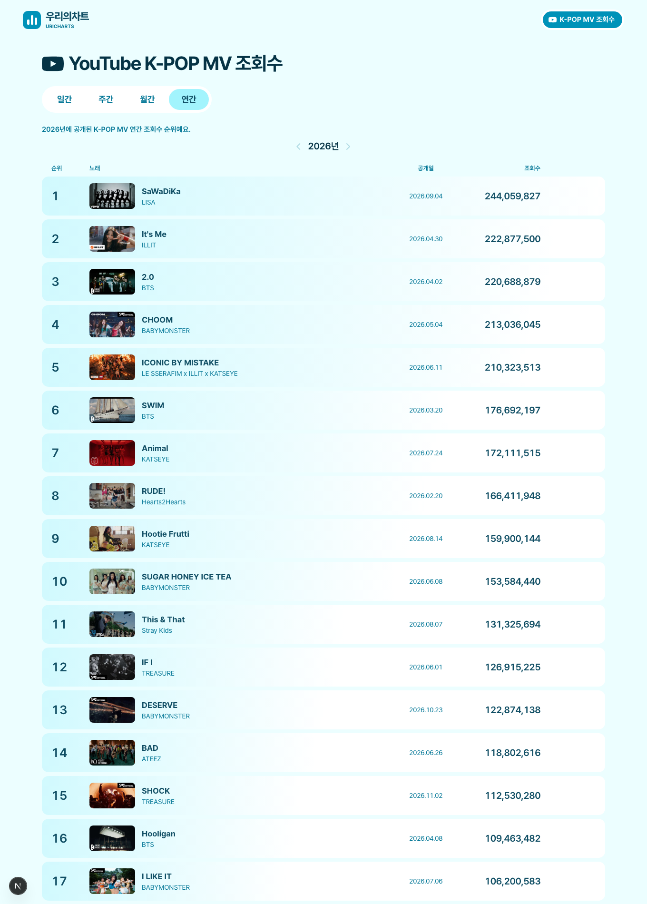 |
| 소개 (새 페이지) | — | 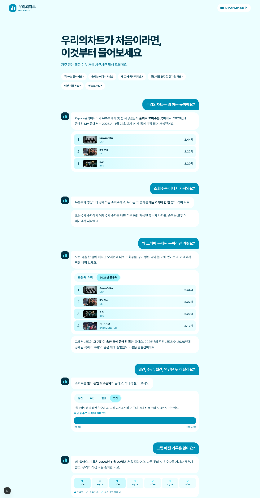 |

> 변경 후 홈 플레이어가 검게 찍힌 것은 headless 캡처 탓이다 (04 참고).

---

## 05 · 2026-11-22 · 차트를 실제 수집 기록으로 (feat/mv-real-data → feat/mv-collector)

**바뀐 점**
- 데이터: 샘플 대신 `data` 브랜치의 매일 0시 조회수 기록으로 계산. 기록이 이틀 이상 쌓이기 전인 일간·주간·월간은 "아직 집계 중이에요 / 매일 0시에 조회수를 기록해요" 빈 카드로 표시
- 홈: "일간 누적 TOP 5" → "누적 일간 조회수 TOP 5"(누적 범위 일간 차트 1~5위), 기간별 카드에 집계 전이면 "집계 중"
- 차트 제목: "YouTube 조회수" → "YouTube K-POP MV 조회수"
- 차트 표 위에 설명 한 줄: "K-POP MV 전체 연간 조회수 순위예요." / "2026년에 공개된 K-POP MV … 순위예요."
- 차트 표: 오른쪽 "누적"(연간+올해 공개곡이면 "하루 평균") 칸 제거, 차트 너비를 데이터가 없을 때도 같게
- 기준 기간: 월간 "2026년 10월 (10월 1일 ~ 10월 31일)" → "2026년 10월", 연간 "2026년 (1월 1일 ~ 11월 20일)" → "2026년"
- 억 단위 줄임 표기: 반올림 없이 소수 둘째 자리에서 자름 (27.7억 → 27.67억, 2억 → 2.00억)
- 캡처 대상에 연간 차트(`/mv/chart/year`) 추가 — 일간이 집계 중이라 표 변화가 연간에서만 보임

| | 변경 전 (feat/mv-collector) | 변경 후 |
|---|---|---|
| 홈 | 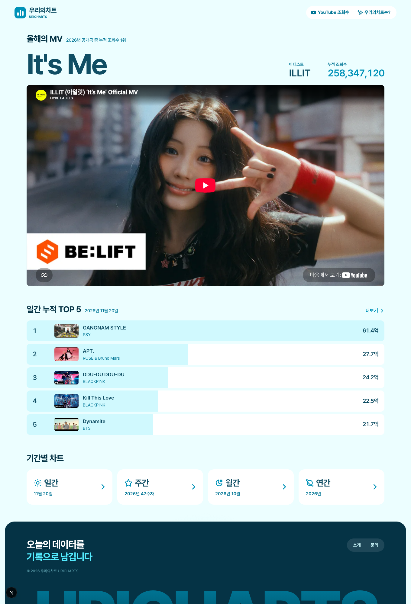 | 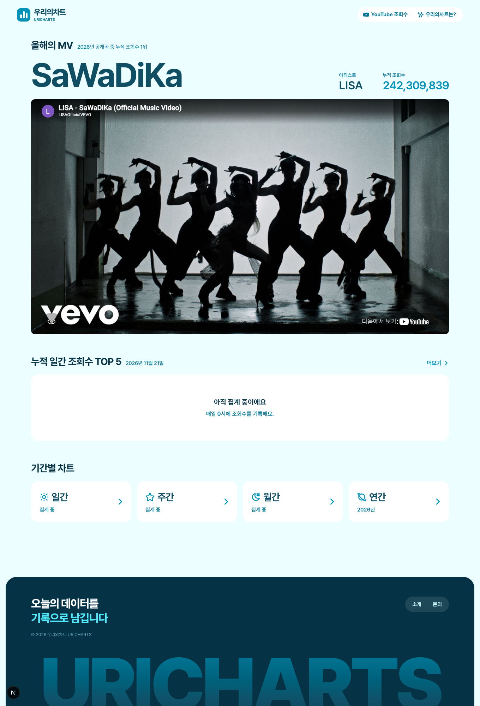 |
| 차트 (일간) |  | 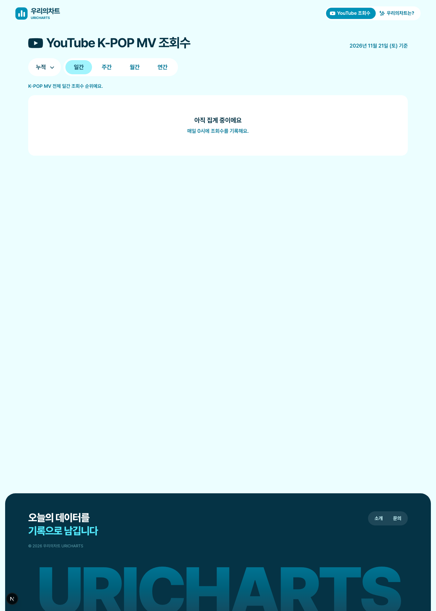 |
| 차트 (연간) | 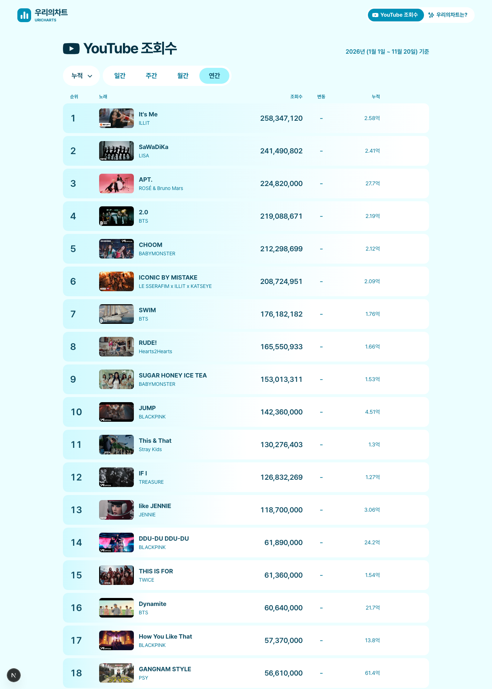 | 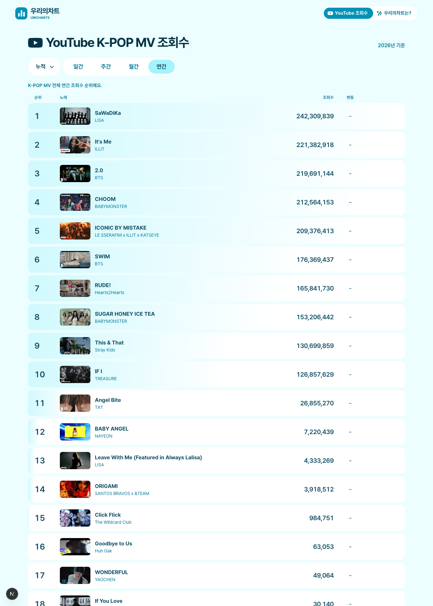 |

> 변경 전은 샘플 데이터, 변경 후는 2026-11-22까지의 실제 기록이라 곡과 숫자가 다르다. 변경 후 홈 플레이어가 검게 찍힌 것은 headless 캡처 탓이다 (04 참고).

---

## 04 · 2026-11-22 · 올해의 MV 플레이어, 기간별 카드 아이콘 (develop → main)

**바뀐 점**
- 홈 올해의 MV: 작은 썸네일 + 세로 정보 → 제목 오른쪽에 아티스트·누적 조회수를 나란히, 그 아래 16:9 유튜브 플레이어(자동 재생 안 함)
- 홈 기간별 차트 카드: 제목 왼쪽에 아이콘 (일간 해 · 주간 별 · 월간 달 · 연간 행성). 호버하면 아이콘도 글자색으로 바뀜
- 샘플 데이터: 1위를 LISA "SaWaDiKa" → ILLIT "It's Me"로 (예시 값)
- 홈 캡처 높이를 1400 → 2000px로 늘림 (플레이어가 들어가며 페이지가 길어짐)

| | 변경 전 (main) | 변경 후 |
|---|---|---|
| 홈 | 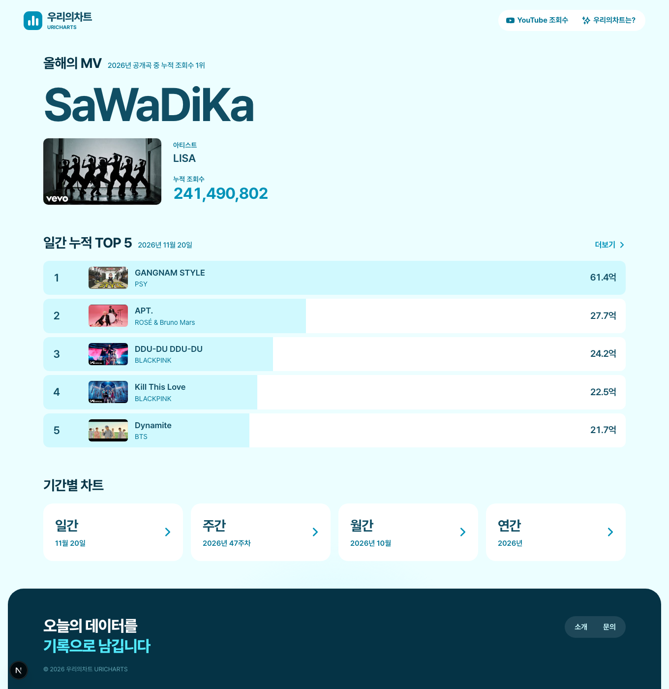 | 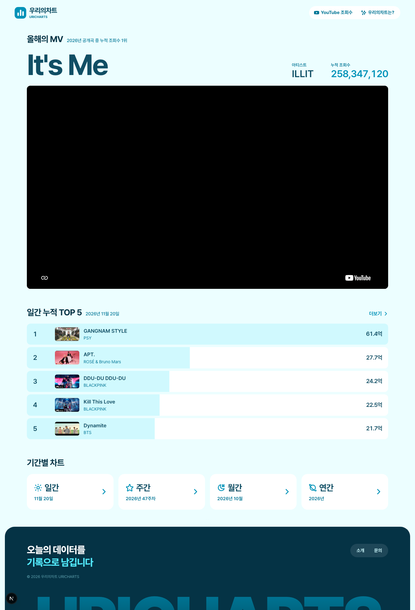 |
| 차트 |  |  |

> 변경 후 홈 캡처에서 플레이어가 검게 찍혔다. headless 캡처에서 유튜브 미리보기 이미지가 늦게 뜨는 탓이고, 실제 브라우저에서는 MV 썸네일과 재생 버튼이 보인다.

---

## 03 · 2026-11-21 · 헤더·푸터 개편, 누적 TOP 5, 뮤직비디오 모달 (develop → main)

**바뀐 점**
- 헤더: 상단 고정(스크롤하면 옅은 그림자), 로고를 cyan 타일 안 흰 막대로. 메뉴는 "YouTube 조회수" · "우리의차트는?" 두 개(홈은 로고), 선택 표시 알약이 메뉴 사이를 미끄러져 이동
- 푸터: 한 줄 안내문 → 깊은 청록 "엔딩 크레딧" 판 (소개 · 문의, ©, 아래로 잘려 걸린 URICHARTS 큰 글자)
- 홈: "어제 TOP 5" → "일간 누적 TOP 5" + 기준일("2026년 11월 20일"), 변동 칸 제거, "차트 전체 보기" → "더보기"
- 차트: 제목 "유튜브 조회수" → 유튜브 아이콘 + "YouTube 조회수", 1위 행 채움 강조 제거, 100위까지 표시
- 아이콘: 직접 그린 꺾쇠 → akar-icons
- 인터랙션 (캡처에는 안 보임)
  - 순위 행을 누르면 유튜브 새 창 대신 화면을 어둡게 덮는 뮤직비디오 모달에서 바로 재생
  - 범위 드롭다운을 기본 select 대신 직접 그린 알약 목록으로 (키보드 ↑↓/Enter/Esc)
  - 로고 호버: 막대가 이퀄라이저처럼 출렁임 / 기간 카드 호버: 흐르는 cyan 그라데이션
  - 홈 TOP 5: 조회수가 평소 오른쪽 끝에 있다가 호버하면 왼쪽으로 비켜 `>` 버튼 자리를 내줌

| | 변경 전 (main) | 변경 후 |
|---|---|---|
| 홈 |  |  |
| 차트 |  | 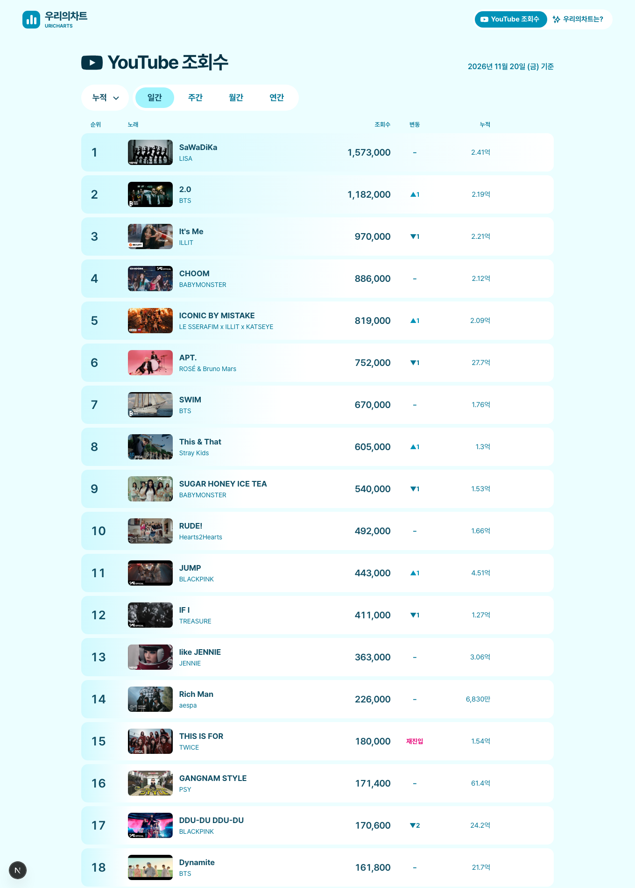 |

> 알려진 문제: 변경 후 차트 페이지 본문이 1184px보다 좁게(내용 폭만큼) 그려진다. `body`가 `flex flex-col`이 되면서 `mx-auto`인 `main`이 내용 폭으로 줄어든 것으로 보인다.

---

## 02 · 2026-11-21 · 홈/차트 페이지 Next.js 구현 (develop → main)

**요청:** HTML 시안(`mockups/`)으로 다듬은 홈·차트 디자인을 실제 Next.js 프로젝트로 옮기고, 시안 파일은 정리.

**바뀐 점**
- 색: 라벤더 → Tailwind cyan 팔레트. 폰트 Pretendard 유지
- 홈: 올해의 MV(누적 조회수 카운트업) · 어제 TOP 5 · 기간별 차트 카드
- 차트 페이지 새로 추가 (`/mv/chart/day|week|month|year`)
  - 제목 "유튜브 조회수" + 오른쪽에 기준일 ("2026년 11월 20일 (금) 기준")
  - 기간 탭: 일간 · 주간 · 월간 · 연간 (기본 일간)
  - 범위 드롭다운: 누적(모든 곡) / 공개연도(고른 연도에 공개된 곡만, 오른쪽에 연도 드롭다운)
  - 표: 순위 · 노래 · 조회수 · 변동 · 누적 (연간 + 올해 공개곡이면 누적 대신 하루 평균)
  - 그룹 필터 칩, ‹ › 이전/다음 기간 버튼, 기간별 큰 제목은 시안 단계에서 뺌
- 인터랙션 (캡처에는 안 보임): 행에 마우스를 올리면 `>>>`가 **한 번만** 지나가고(1.1초) 끝에 `>` 버튼이 나타남. 홈 TOP 5도 동일
- 썸네일이 뜨기 전 자리 색을 곡별 색 대신 cyan으로 통일

| | 변경 전 (main) | 변경 후 |
|---|---|---|
| 홈 |  |  |
| 차트 | (페이지 없음) |  |

> 참고: main의 홈은 Next.js 기본 시작 페이지라, 직전 디자인과 비교하려면 01 기록의 시안 캡처(`01-20261121-lavender-pretendard/after/`)를 함께 본다.
> 캡처 왼쪽 아래 `N` 배지는 Next.js 개발 서버 표시로, 배포 화면에는 없다.

---

## 01 · 2026-11-21 · 라벤더 톤 + Pretendard + 호버 레이싱 화살표

**요청:** 1번(스코어보드) 시안 채택. 폰트를 Pretendard로 통일, 사이트 이름을 "우리의차트"로, 파랑 대신 튀지 않는 라벤더 계열로. 차트 행에 마우스를 올리면 `>>>`가 오른쪽으로 달려가며 보러가기 `>` 버튼이 나타나도록.

**바뀐 점**
- 폰트: Black Han Sans + Archivo + Gothic A1 → Pretendard 하나로 통일
- 이름/로고: "MV 스코어보드" → "우리의차트" (막대 3개 로고)
- 색: 배경 `#1F2BFF` → `#5D5499`, 강조 노랑 `#FFE14D` → 옅은 라벤더 `#DCD3FF`
- 차트 행: 호버 시 레이싱 화살표 + 원형 `>` 버튼, 클릭하면 유튜브로 이동 (홈 TOP 5에도 적용)

| | 변경 전 | 변경 후 |
|---|---|---|
| 홈 |  |  |
| 차트 |  |  |
| 차트 호버 | (호버 효과 없음) |  |

> 참고: 이 기록은 PR 기준 규칙을 정하기 전, 시안 단계에서 만든 것입니다. 이 기록의 "변경 전" 홈 이미지는 기록 규칙을 만들기 전에 찍어둔 것이라, 실제 직전 상태와 히어로 아래 문구 한 줄이 다릅니다.
